<!--
  ╔══════════════════════════════════════════════════════════════════╗
  ║  OWNER NOTES (delete this block before publishing if you like)   ║
  ║  1. Coupon links use the draft course URL. Once the course is    ║
  ║     public, find & replace  udemy.com/course/draft/7325131/      ║
  ║     with  udemy.com/course/<your-public-slug>/                   ║
  ║  2. Coupon expiry dates below are calculated from 2026-10-24.    ║
  ║     Update the table when you create new coupons.                ║
  ╚══════════════════════════════════════════════════════════════════╝
-->

<div align="center">


# Build a Real-Time Social Network from Scratch

### Next.js 16 · Flask · Socket.IO · MongoDB · Redis · Docker · Kubernetes · CI/CD

**Not another to-do app.** Build, test, containerize and deploy a *real* full-stack social platform, with live chat, live notifications, online presence, automated tests and a Kubernetes-ready backend.

<br/>

[](https://www.udemy.com/course/draft/7325131/?couponCode=PROMOCODEONE)
&nbsp;
[](https://www.udemy.com/course/draft/7325131/?couponCode=PROMOCODEONE)

<br/>


<br/>

**6 sections &nbsp;•&nbsp; 172 lectures &nbsp;•&nbsp; 32h 30m of content &nbsp;•&nbsp; Updated for 2026**

</div>

---

## 🎟️ Get the Course at the Lowest Price

Skip the full Udemy price. Use one of the links below and the discount is applied automatically at checkout.
https://www.udemy.com/course/full-stack-nextjs-flask-social-app-real-time-2026/?couponCode=AE19341811CE1B81EF51
| Offer | Price | Expires | Enroll |
|:------|:-----:|:-------:|:------:|
| 🔥 **`ACAA29FC84671C1CB5B2`**: best price, limited time | **$9.99** | **Oct 29, 2026** | [**Claim this price →**](https://www.udemy.com/course/full-stack-nextjs-flask-social-app-real-time-2026/?couponCode=ACAA29FC84671C1CB5B2) |
| ✅ **`AE19341811CE1B81EF51`**: still a great deal | **$12.99** | **Nov 23, 2026** | [**Claim this price →**](https://www.udemy.com/course/full-stack-nextjs-flask-social-app-real-time-2026/?couponCode=AE19341811CE1B81EF51) |

> 💡 **Tip:** Click the link rather than typing the code by hand. Udemy applies the coupon for you, and you can see the final price before you pay.
> Coupons are time-limited and Udemy may cap how many people can redeem them, so grab yours while the price is at its lowest.

---

## 🚀 What You Will Build

A complete, production-style social media platform. It is the kind of project you can put in your portfolio and explain in an interview.

- 👤 **Users & profiles**: Instagram-style profile pages with bio, followers and following counts
- 📝 **Posts**: create posts with images, edit them later, delete them
- ❤️ **Likes & comments**: interact with any post, add and remove comments
- 🏠 **Feed**: your posts plus your friends' posts, with pagination so you can keep scrolling back through older posts
- 🔎 **Search**: find users, posts, or both
- 🤝 **Friend suggestions**: a "People you may know" panel that suggests users to follow
- 💬 **Real-time chat**: live messages, message history, unread counters
- 🟢 **Online presence**: see which connections are online right now
- 🔔 **Live notifications**: real-time alerts you can mark as read
- 🔐 **Authentication**: JWT-based auth and authorization

---

## 📸 See It in Action

### Home feed: create posts with images

<p align="center">
  
</p>

### Edit your posts after publishing

<p align="center">
  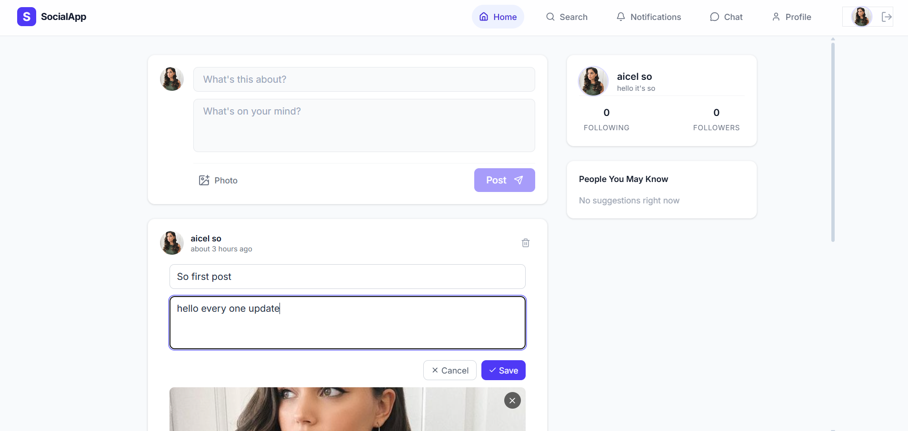
</p>

### Search users, posts, or both

<table>
  <tr>
    <td align="center" width="50%">
      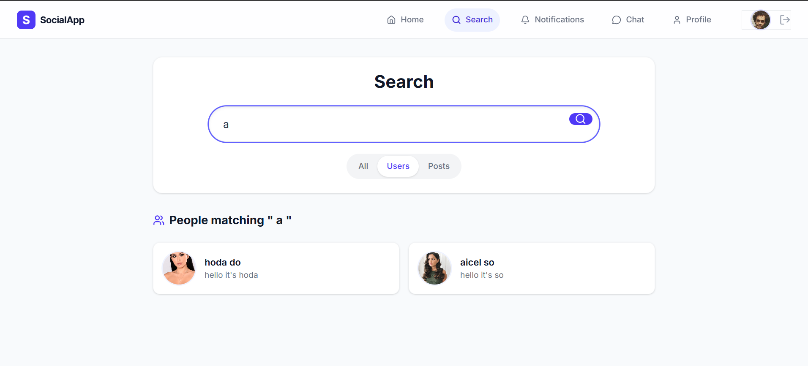<br/>
      <sub><b>Users-only results</b></sub>
    </td>
    <td align="center" width="50%">
      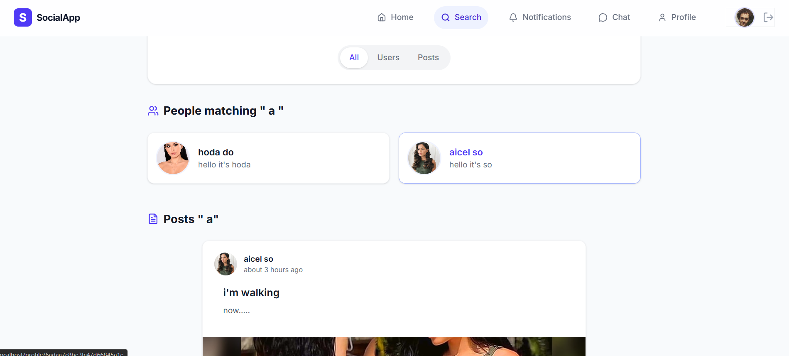<br/>
      <sub><b>Users and posts together</b></sub>
    </td>
  </tr>
</table>

### Real-time chat with online status and unread counters

Your connections sit on the left with **online/offline status** and a **badge for unread messages**. The conversation sits on the right, delivered live over WebSockets, with older messages loading as you scroll back.

<p align="center">
  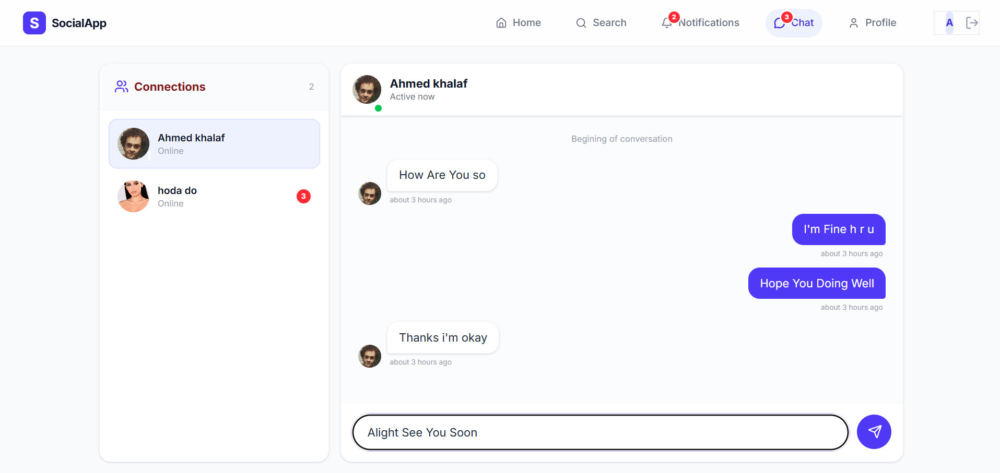
</p>

### Live notifications

Notifications, user status and messages all update in real time, with no page refresh. Mark notifications as read right from the page.

<p align="center">
  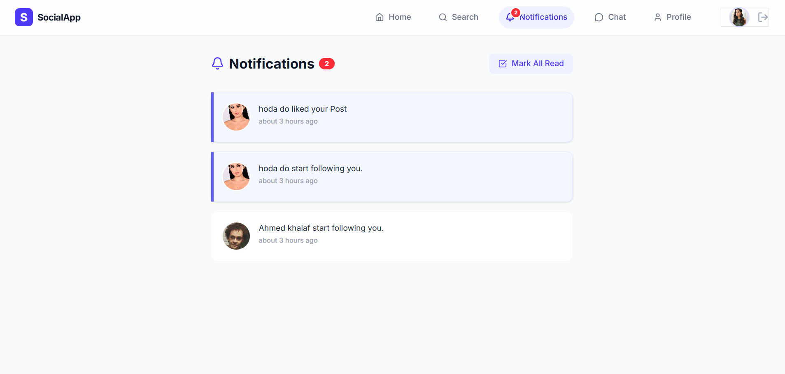
</p>

### Friend suggestions, profiles and comments

<table>
  <tr>
    <td align="center" width="33%">
      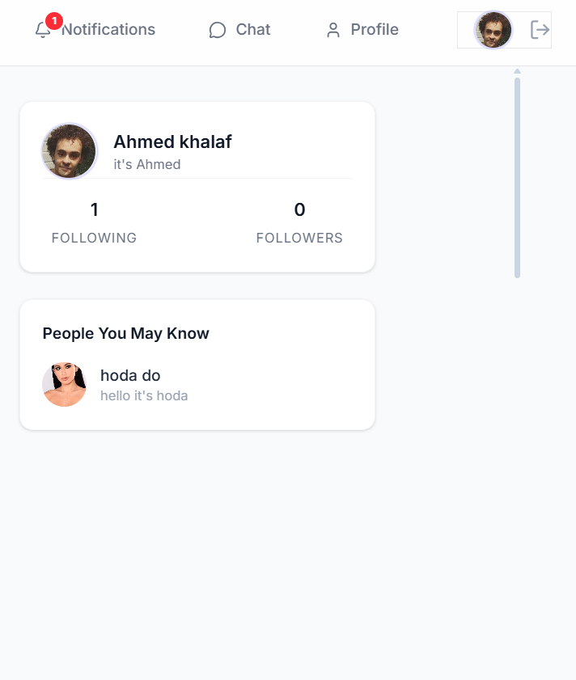<br/>
      <sub><b>People you may know</b></sub>
    </td>
    <td align="center" width="33%">
      <br/>
      <sub><b>Instagram-style profiles</b></sub>
    </td>
    <td align="center" width="33%">
      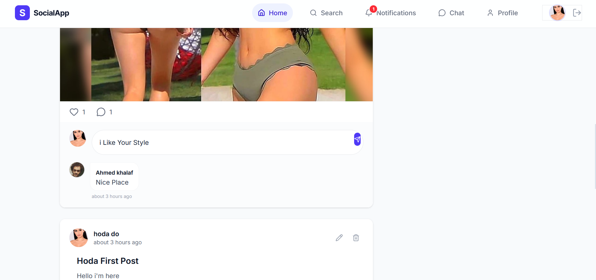<br/>
      <sub><b>Add &amp; delete comments</b></sub>
    </td>
  </tr>
</table>

---

## 🏗️ The Architecture You Will Understand

Most courses stop when the app runs on `localhost`. This one goes further, to a **horizontally scalable real-time backend** running on Kubernetes.

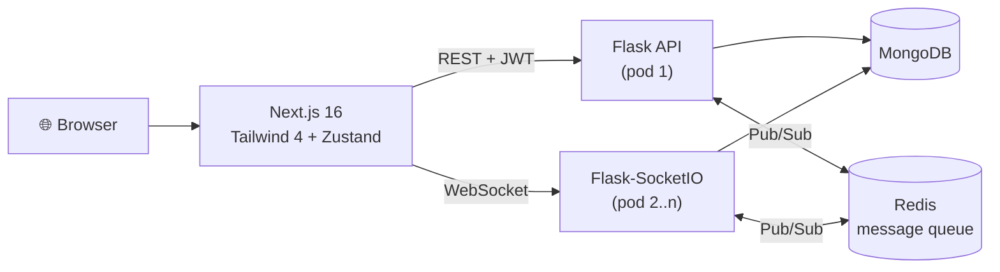

**Why Redis matters:** with several Flask pods running, a message sent to one pod must still reach a user connected to another. The course shows you the problem first, then solves it with Redis Pub/Sub as the Socket.IO message queue, so you understand *why* and not just *how*.

---

## 🧪 Real Testing & CI/CD, Not an Afterthought

Plenty of tutorials skip testing. This course builds it into the workflow, with **unit tests, integration tests and end-to-end tests** wired into a **GitHub Actions** pipeline that runs on every push and finishes by building and pushing your Docker images.

<p align="center">
  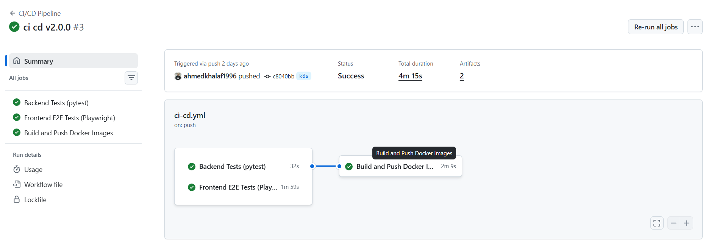
</p>

<table>
  <tr>
    <td align="center" width="50%">
      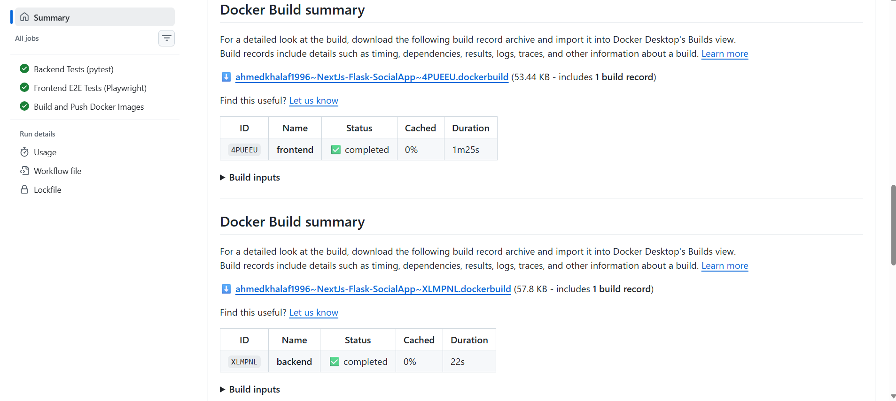<br/>
      <sub><b>Job summaries for unit tests and Docker builds</b></sub>
    </td>
    <td align="center" width="50%">
      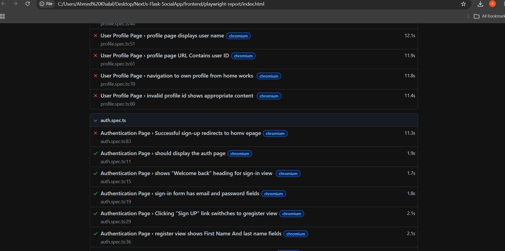<br/>
      <sub><b>Playwright HTML report for E2E tests</b></sub>
    </td>
  </tr>
</table>

---

## 🎓 What You'll Learn

<details open>
<summary><b>Full-stack development</b></summary>

- Build a complete social media web app from scratch with **Next.js** and **Flask**
- Build a modern frontend with **Next.js 16** and **Tailwind CSS 4**
- Manage frontend auth and application state with **Zustand**
- Implement users, profiles, posts, likes, comments, pagination, friend suggestions and notifications

</details>

<details open>
<summary><b>Backend & real-time</b></summary>

- Develop a production-style **REST API** with Python Flask
- Build real-time chat, online friends and live notifications with **Flask-SocketIO**
- Use **MongoDB** as the primary database
- Use **MongoDB aggregation pipelines** to retrieve and combine related data efficiently
- Build authentication and authorization with **JWT**

</details>

<details open>
<summary><b>Testing & automation</b></summary>

- Write backend unit tests with **Pytest**
- Create backend integration tests for your API
- Write end-to-end tests for the Next.js app with **Playwright**
- Build a **GitHub Actions** CI pipeline that runs your tests on every push

</details>

<details open>
<summary><b>Scaling, Docker & Kubernetes</b></summary>

- Prepare a real-time Flask app for **horizontal scaling**
- Use **Redis Pub/Sub** as a message queue for Socket.IO
- Understand why Redis becomes essential when Socket.IO runs across multiple **Kubernetes pods**
- Create scripts that automate Kubernetes deployment and application updates
- See the whole path: **development → testing → CI → containerization → Kubernetes**

</details>

---

## 👥 Who Is This Course For?

- Developers who have built small CRUD apps and want to build **something real**
- Frontend developers who want to understand the backend, real-time and DevOps side
- Python developers who want a modern **Next.js** frontend on top of Flask
- Anyone preparing a **portfolio project** that shows full-stack, testing and deployment skills together

---

## 📦 What's In This Repository

This repo holds the finished project that you build step by step in the course.

```text
NextJs-Flask-SocialApp/
├── backend/             # Flask REST API + Flask-SocketIO (Python)
├── frontend/            # Next.js app (Tailwind CSS, Zustand)
├── k8s/                 # Kubernetes manifests
├── .github/workflows/   # GitHub Actions CI/CD pipelines
├── imges/               # Screenshots used in this README
├── deploy.bat           # Deployment helper script
├── run-local-k8s.bat    # Start the app on a local Kubernetes cluster
├── stop-k8s.bat         # Stop the local Kubernetes deployment
├── run_test.sh          # Run the test suites (Linux / macOS)
└── run_tests.ps1        # Run the test suites (Windows PowerShell)
```

Browse the code, star the repo, and when you want to understand *every line and why it was written that way*, the course walks you through it from an empty folder.

---

## 💡 Why Take the Course Instead of Just Reading the Code?

| Reading the repo | Following the course |
|:-----------------|:---------------------|
| See the final result | Build it from an empty folder, step by step |
| Guess why decisions were made | Hear the reasoning behind each design choice |
| Run into errors alone | See common problems solved as they come up |
| Code only | Code, testing, CI/CD and Kubernetes deployment in one workflow |
| No lasting reference | 32+ hours you can rewatch any time, at your own pace |

---

## 🔥 Ready to Build It?

<div align="center">

### Pick your price and start today

[](https://www.udemy.com/course/draft/7325131/?couponCode=ACAA29FC84671C1CB5B2)

[](https://www.udemy.com/course/draft/7325131/?couponCode=AE19341811CE1B81EF51)

<br/>

⭐ **Found this useful? Give the repo a star.** It helps other developers find it.

</div>

---

## 🙋 Questions?

- Open an [issue](https://github.com/ahmedkhalaf1996/NextJs-Flask-SocialApp/issues) on this repo
- Ask in the Q&A section of the Udemy course

Built by [@ahmedkhalaf1996](https://github.com/ahmedkhalaf1996) 🚀
